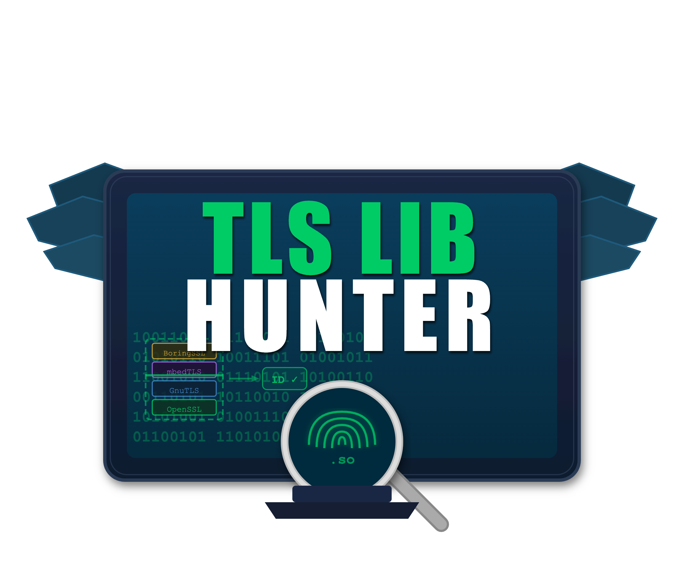

<div align="center">
    
    <p></p><strong>Identifying TLS Libraries Within Processes</strong></div></p>
</div>


# TLSLibHunter
 [](https://badge.fury.io/py/tlslibhunter) [](https://github.com/monkeywave/tlsLibHunter/actions/workflows/publish.yml)
[](https://github.com/monkeywave/tlsLibHunter/actions/workflows/lint.yml)


Identify and extract TLS/SSL libraries from running processes using dynamic instrumentation.

## Installation

```bash
pip install tlsLibHunter
```

## Quick Start

### CLI Usage

```bash
# List TLS libraries in a local process
tlsLibHunter firefox -l

# Scan and extract TLS libraries
tlsLibHunter firefox

# Android device
tlsLibHunter com.example.app -m -l

# JSON output
tlsLibHunter firefox -l -f json

# Full, unfiltered diagnostic scan (show known false positives + low-confidence hits)
tlsLibHunter com.example.app -m -l --scan-everything

# Debug run — also writes everything shown in the terminal to a log file
tlsLibHunter com.example.app -m -l -d
```

### Example output:

```bash
tlslibhunter -m -l Chrome
INFO: Platform: android
INFO: Found 324 loaded modules
INFO: Pattern match in libssl.so: 1 hits
INFO: Detected: libssl.so (boringssl, system)
INFO: Pattern match in libmonochrome_64.so: 1 hits
INFO: Fingerprint: libmonochrome_64.so identified as boringssl
INFO: Detected: libmonochrome_64.so (boringssl, app)
INFO: Scan complete: 2 TLS libraries found in 298 modules (8.06s)
        				TLS Libraries in 'Chrome' (android)                    
┏━━━━━━┳━━━━━━━━━━━━━━━━━━━━━┳━━━━━━━━━━━┳━━━━━━━━┳━━━━━━━━━━━┳━━━━━━━━━━━━━━━━━━━━━━━━━━━━┓
┃ #    ┃ Library             ┃ Type      ┃ Class  ┃      Size ┃ Path                       ┃
┡━━━━━━╇━━━━━━━━━━━━━━━━━━━━━╇━━━━━━━━━━━╇━━━━━━━━╇━━━━━━━━━━━╇━━━━━━━━━━━━━━━━━━━━━━━━━━━━┩
│ 1    │ libssl.so           │ boringssl │ system │ 376.0 KiB │ /apex/com.…                │
│ 2    │ libmonochrome_64.so │ boringssl │ app    │ 119.1 MiB │ /data/app/~~NlI…           │
└──────┴─────────────────────┴───────────┴────────┴───────────┴────────────────────────────┘

Scanned 298 modules in 8.06s
```


### Python API

```python
from tlslibhunter import TLSLibHunter

# Scan a local process
hunter = TLSLibHunter("firefox")
result = hunter.scan()
for lib in result.libraries:
    print(f"{lib.name} ({lib.library_type}) - {lib.path}")

# Scan and extract
result = hunter.scan()
extractions = hunter.extract(result, output_dir="./extracted_libs")
```

## Features

- Memory scanning for TLS string patterns
- Supports OpenSSL, BoringSSL, GnuTLS, wolfSSL, mbedTLS, NSS, SChannel, SecureTransport
- Multi-platform: Android, iOS, Windows, Linux, macOS
- Multiple extraction methods: disk copy, ADB pull, APK extraction, memory dump
- Clean Python API for programmatic use
- Backend abstraction (currently only frida but might be extended to other frameworks in the future)


## Result filtering & scan depth

By default the results table is curated to show only **genuine, hookable TLS stacks** so the
output stays actionable:

- **Confidence threshold** — only `medium`- and `high`-confidence detections are shown. The long
  tail of `low`-confidence hits (coincidental 4-byte ASCII fragments) is hidden.
- **Known false positives** — crypto-primitive and JNI-wrapper libraries that carry TLS strings
  (and may even re-export `SSL_*` symbols) but are **not** independently hookable TLS stacks are
  skipped during scanning. This currently covers `libcrypto.so` /
  `stable_cronet_libcrypto.so` (BoringSSL/OpenSSL primitives) and `libjavacrypto.so` (the
  Conscrypt JNI bridge). The real key-extraction targets — `libssl.so`, `libcronet*`,
  `stable_cronet_libssl.so` — are kept.

Hidden detections are never lost silently: the scan summary logs how many were hidden, and the
names are recorded in `pipeline_stats` (`hidden_low_confidence_names`,
`hidden_false_positive_names`, `false_positive_skipped_names`).

To see **everything** (known false positives, low-confidence rows, and the verbose weak-evidence
breakdown), run a full scan with `--scan-everything`. This is the only flag that disables the
default filters.

### Debug log file

Passing `-d` / `--debug` additionally tees **all terminal output** (the results table plus every
log line) into a timestamped, ANSI-stripped file in the current directory, named
`tlslibhunter_<target>_<YYYYmmdd-HHMMSS>.log`.


